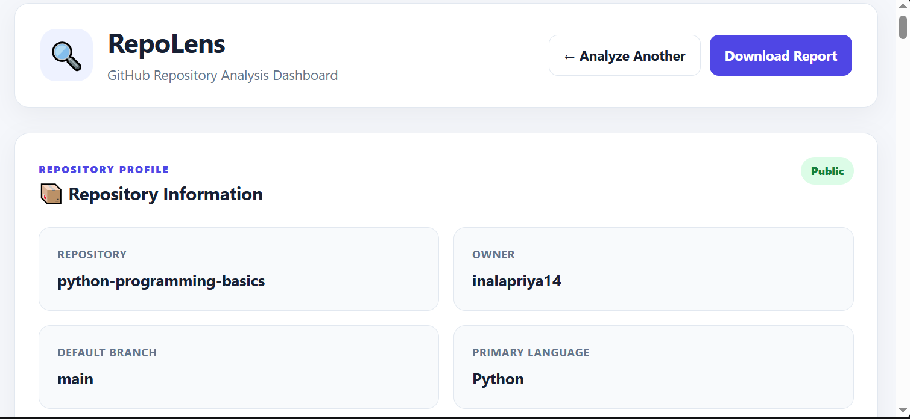
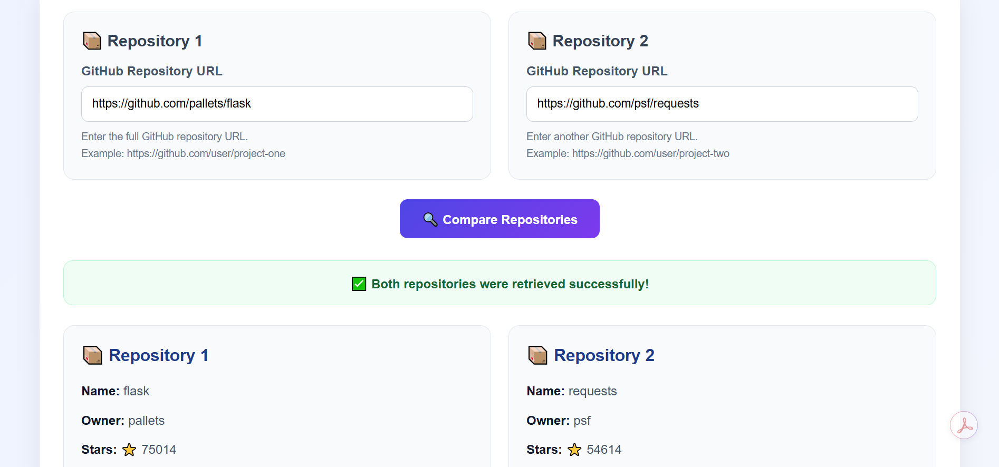

# 🔍 RepoLens — GitHub Repository Analyzer

RepoLens is a web application built with Python and Flask that analyzes public GitHub repositories and presents useful information through a visual dashboard.

## Features

- Repository statistics: stars, forks, and open issues
- Programming language distribution and charts
- Repository file and folder structure
- Documentation and README analysis
- Code metrics and dependency analysis
- Repository risk analysis
- Security hygiene checks and recommendations
- Repository activity and contributor analysis
- Issues and pull request analysis
- Comparison of two GitHub repositories
- Dashboard search and navigation
- Downloadable PDF reports

## Technologies Used

- Python
- Flask
- GitHub REST API
- HTML
- CSS
- JavaScript
- Chart.js
- ReportLab

## Installation and Setup

### 1. Clone the repository

```bash
git clone https://github.com/inalapriya14/RepoLens.git
cd RepoLens
```

### 2. Create a virtual environment

```bash
python -m venv venv
```

### 3. Activate the environment

For Windows PowerShell:

```powershell
.\venv\Scripts\Activate.ps1
```

### 4. Install dependencies

If `requirements.txt` exists:

```bash
pip install -r requirements.txt
```

### 5. Run the application

```bash
python app.py
```

Open http://127.0.0.1:5000 in your browser.

## How to Use

1. Open RepoLens in your browser.
2. Enter a public GitHub repository URL.
3. Run the analysis.
4. Explore the repository statistics, charts, documentation, security checks, and other results.
5. Compare repositories or download a PDF report.

## Project Objective

The goal of RepoLens is to make GitHub repository information easier to understand by bringing repository statistics, analysis, and visualizations together in one dashboard.

## Future Enhancements

- More advanced code quality analysis
- Expanded security checks
- Historical repository analytics
- Additional report customization

## Author

**Priya Reddy**

GitHub: https://github.com/inalapriya14

## License

A license has not yet been selected for this project.

## 📸 Screenshots

### Repository Analytics Dashboard


### Repository Comparison



